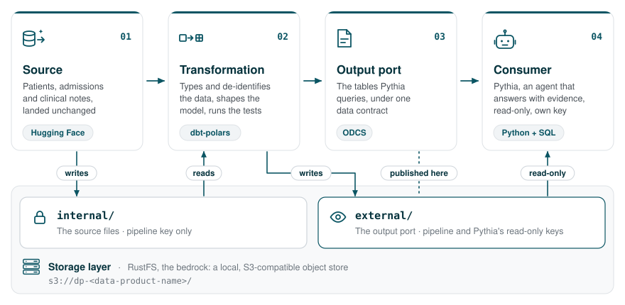

# Pythia NHS Synthetic

*Pythia — ask your data. Get answers you can check.*

[](#status)
[](https://www.python.org/)
[](https://docs.astral.sh/uv/)
[](https://github.com/datamindedbe/incubator-dbt-polars)
[](LICENSE)
[](https://jrverbiest.eu/projects/pythia/pythia.html)

An AI agent that answers questions about patients in plain language, on a
contract-first health data product built from NHS England's synthetic patients
and clinical notes. The full design is written up on the
[Pythia project page](https://jrverbiest.eu/projects/pythia/pythia.html).

> [!NOTE]
> **Personal project · work in progress.** Not affiliated with NHS England or
> any other organisation, and not formal research.

## Why

In ancient Greece, the Pythia answered questions at Delphi. Her answers were
famously ambiguous. This Pythia takes the opposite approach: clear answers from
your data, with evidence you can check — and an explicit admission when the
data cannot answer.

| Goal | What it means |
| --- | --- |
| **Clear answers about patients** | A question goes in; an answer comes out with its evidence, so it can be checked rather than trusted. When the data does not hold the answer, Pythia says so instead of guessing. |
| **Show that a contract-first data product makes AI better** | Pythia reads only what the data product publishes at its output port, under a data contract. The contract pays off twice: Pythia gets data it can trust, and the contract's description of every table and column is the metadata Pythia reads before it writes a query. |

## What

### The data product

The data product is a health dataset made ready to be used: built from NHS
England's synthetic patients and notes, described and tested by a data
contract, and reached only through its output port.

<picture>
  <source media="(prefers-color-scheme: dark)" srcset="docs/images/data-product-dark.svg">
  
</picture>

| Step | What happens |
| --- | --- |
| **01 Source** | Three CSV files from [Hugging Face](https://huggingface.co/datasets/NHSEDataScience/synthetic_clinical_notes) — patients, admissions and clinical notes — landed unchanged. |
| **02 Transformation** | [dbt-polars](https://github.com/datamindedbe/incubator-dbt-polars) models type the files, take the identifiers out, shape the data model and cut the notes into passages — then dbt tests check it all against the contract. |
| **03 Output port** | The tables Pythia queries, under one data contract in the [Open Data Contract Standard](https://bitol-io.github.io/open-data-contract-standard/) (ODCS) from [Bitol](https://bitol.io/). |
| **04 Consumer** | Pythia, an agent in Python and SQL — read-only, with a key of its own. |

All four rest on one storage layer: [RustFS, the bedrock](https://github.com/JrVerbiest/RustFS-the-bedrock),
a local, S3-compatible object store. The data product is one bucket in it,
`s3://dp-<data-product-name>/`, which dbt-polars reaches through its S3 catalog.

### The data: synthetic patients and notes

The data comes from NHS England's [synthetic clinical notes](https://arxiv.org/html/2606.26879v2):
synthetic patients made with [Synthea](https://synthea.mitre.org/), given
hospital admissions, with the notes of each stay written by a language model.
Its Silver dataset,
[`NHSEDataScience/synthetic_clinical_notes`](https://huggingface.co/datasets/NHSEDataScience/synthetic_clinical_notes)
on Hugging Face, holds 70 patients and about 1,600 notes under the MIT licence.
*Silver* means not yet reviewed by clinicians. The
[pipeline that makes it](https://github.com/nhsengland/synthetic_clinical_notes)
is open source.

| File | Holds |
| --- | --- |
| `silver/patients.csv` | The synthetic patients |
| `silver/admissions.csv` | Their hospital admissions |
| `silver/synthetic_clinical_notes.csv` | The machine-written clinical notes of each stay |

> [!WARNING]
> **Synthetic data, not for clinical use.** Pythia works on synthetic patients
> and machine-written notes. It is not a clinical tool, it gives no medical
> advice, and it is not intended for any real healthcare setting.

## How

### Where the data lives

The bedrock keeps Pythia away from the source: the bucket has two folders, and
each key reaches only what its role needs.

| Folder | Holds | Reached by |
| --- | --- | --- |
| `internal/` | The source files, with names, NHS numbers and dates of birth | The pipeline's key only |
| `external/` | The output port: the de-identified tables | The pipeline's key, and Pythia's read-only key |

The pipeline's key can write but never delete. Pythia's key cannot list or read
`internal/`, and the bedrock's smoke test tries every forbidden action and fails
unless the store refuses it.

> [!WARNING]
> **Local development only.** The bedrock is one beta node, plain HTTP, no
> backup — for developing a data product, not for running one.

### Design on best practices

The data is synthetic, but Pythia is built as if it were not — following the
best practices for handling health data and for putting an AI system in front
of people.

| Principle | In practice |
| --- | --- |
| **Privacy by design** | Only the data the purpose needs. The output port carries no names, NHS numbers or full dates of birth, and the notes are de-identified before they are published. |
| **Described and checked** | The contract describes every table and column, every run is checked against it, and dbt's lineage leads back to the source file. |
| **Open about AI** | Pythia says it is an AI before the first question, shows the evidence behind every answer, labels the notes as machine-written, and traces every answer. |

## Getting started

What runs today: install the environment and download the dataset.

### Requirements

| Tool | Why |
| --- | --- |
| [uv](https://docs.astral.sh/uv/) | Creates the Python environment and runs every command below |
| Python 3.12 or 3.13 | `.python-version` pins 3.12; uv fetches it if missing. dbt-polars does not support 3.14 yet |
| [RustFS, the bedrock](https://github.com/JrVerbiest/RustFS-the-bedrock) | Only once the pipeline writes to S3; it needs Docker Desktop |

### Download the dataset

```bash
uv sync
uv run python scripts/download_dataset.py
```

The files land in `data/synthetic_clinical_notes/`, which is gitignored. Pass
`--dest <dir>` to download somewhere else. Re-running skips files that are
already there. A gated or rate-limited download can need a Hugging Face login:
`uv run hf auth login`.

### The dbt project

[`dbt/`](dbt/) holds the dbt-polars project, `pythia_nhs_synthetic`. It is a
skeleton for now: no models yet. Run dbt through uv, from inside that folder:

```bash
cd dbt
uv run dbt --version
```

dbt reads its connection settings from a profile in `~/.dbt/profiles.yml`,
outside this repository, so no credentials are ever committed. dbt-polars has
no default storage, so the profile names a *catalog*: the local disk, or the
bedrock's S3 API through the `s3` catalog. dbt-polars does not support views;
models are materialised as `table` or `ephemeral`.

## Licence

Code: MIT — see [LICENSE](LICENSE). The dataset has its own licence (MIT), set
by NHS England; see its [Hugging Face page](https://huggingface.co/datasets/NHSEDataScience/synthetic_clinical_notes).
